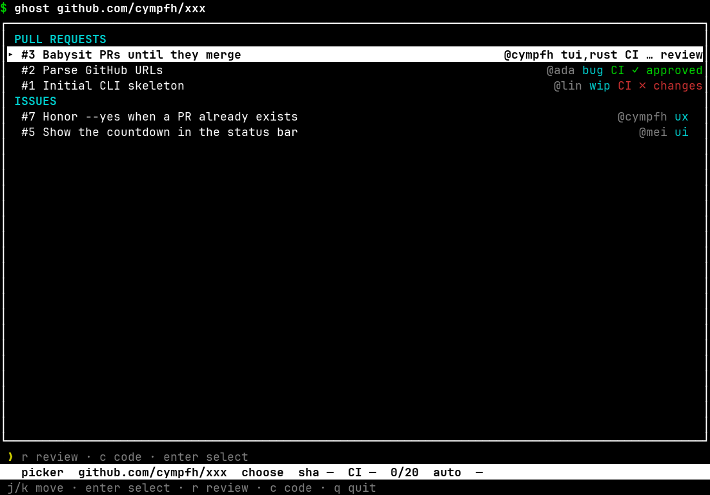
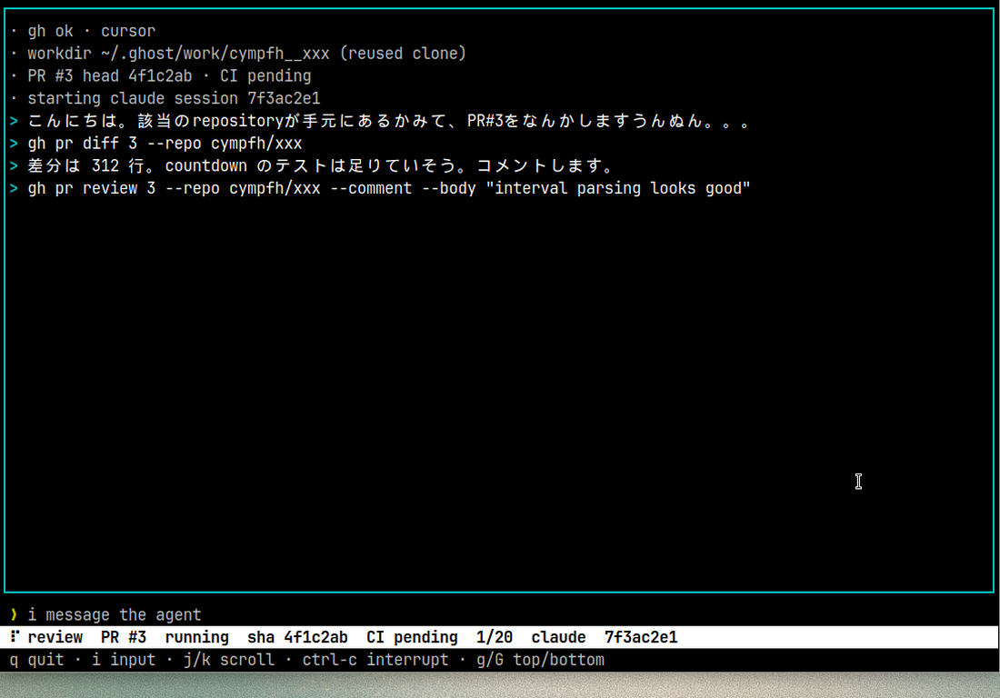
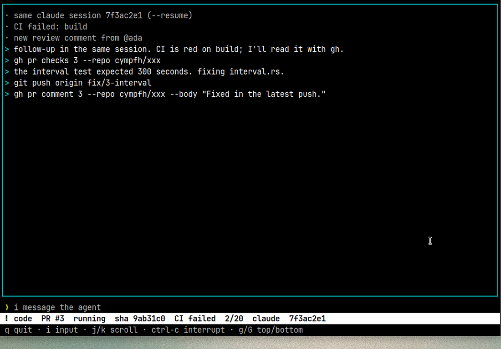
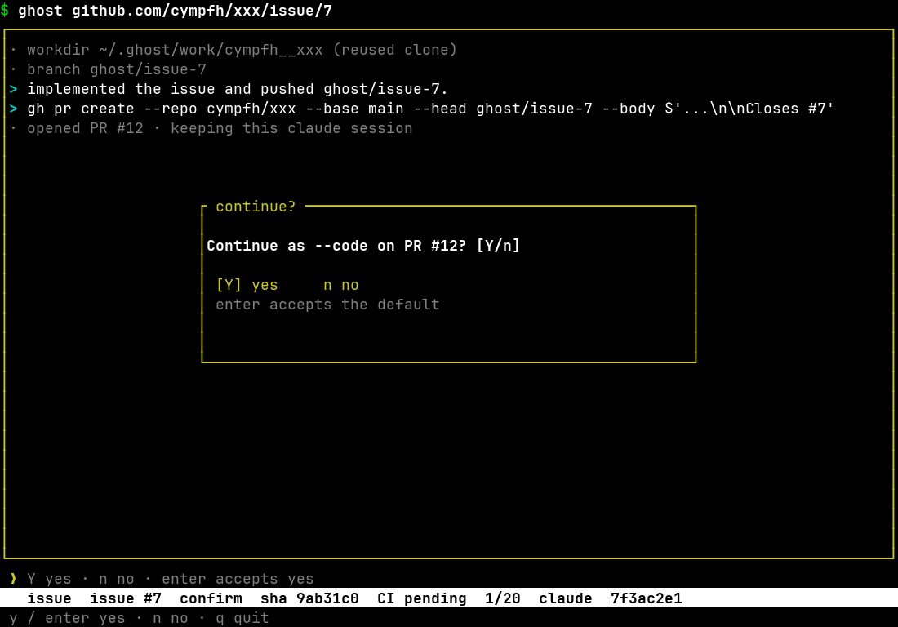

<p align="center"></p>

# ghost

[English](README.md) | [日本語](README.ja.md)

ghost has a local coding agent review a pull request, implement an issue, or fix CI failures and review comments. When the pull request is mergeable, it confirms with you and then merges itself.

## Requirements

You need the [GitHub CLI](https://cli.github.com/) (`gh auth login`) and one of `codex`, `claude`, or `grok` on `PATH`.

```sh
cargo install --path .
```

If `gh` is missing, not logged in, or cannot read the repository, ghost explains the fix and exits.

## Usage

```sh
ghost github.com/OWNER/REPO                  # pick an open pull request or issue
ghost github.com/OWNER/REPO/pr/N --review    # review
ghost github.com/OWNER/REPO/pr/N --code      # fix CI failures and review comments
ghost github.com/OWNER/REPO/issue/N          # implement, open a pull request, then keep fixing
ghost github.com/OWNER/REPO/issue/N --yes    # same, accepting the continue prompt
```

A pull request URL with no flag asks whether to review or to fix.

A repository with nothing open prints one line and exits.

A repository URL with `--review` or `--code` is an error. `--review` on an issue URL is an error.

A pull request is mergeable when it is open, not a draft, free of conflicts, has no outstanding change requests, and every listed check has passed. When no checks are listed, CI is not part of that decision. ghost confirms with you before merging, and `--merge-yes` merges without that confirmation.

| Short | Long | Default | Description |
| --- | --- | --- | --- |
| `-r` | `--review` | | Review the pull request. Cannot be combined with `-c`. |
| `-c` | `--code` | | Fix failing CI and new review comments. Cannot be combined with `-r`. |
| `-i` | `--interval` | `20s` | How often to check GitHub (`30s`, `2m`, `1h30m`, or a number of seconds). |
| `-a` | `--agent` | first on `PATH` | `codex`, `claude`, or `grok`. |
| `-k` | `--ssh-key` | ssh config, or `GHOST_SSH_KEY` | Private key passed to ssh. |
| `-l` | `--lang` | `ja` (`GHOST_LANG` if the flag is omitted) | `ja` or `en`. |
| `-y` | `--yes` | | Accept the continue prompt and the review-exit prompt. Does not merge. |
| | `--merge-yes` | | Merge without confirming. Only with `--code` or an issue. |
| | `--merge-method` | `squash` | `merge`, `squash`, or `rebase`. |
| `-n` | `--max-iterations` | `20` | Stop after this many agent turns. |
| `-t` | `--trust-comments` | `all` | Who may wake `--code`: `all`, `collaborators`, or `contributors`. |
| `-d` | `--demo` | | Draw a sample screen: `picker`, `review`, `code`, `confirm`, `preflight`, or `splash`. |
| `-h` | `--help` | | Help. |
| `-V` | `--version` | | Version. |

## Screen and keys









- `q` quits ghost.
- `i` sends one line to the agent from the log screen. If a turn is running, the line is delivered when that turn ends.
- `ctrl-c` interrupts the current turn and leaves the session. On a confirm screen it does the same as `n`.

| Screen | `y` | `n` / Esc | Enter | `c` | `m` |
| --- | --- | --- | --- | --- | --- |
| Merge confirm | Merge | Exit ghost without merging | Exit ghost without merging | Stay in the session | Cycle the method |
| Review-end confirm | Exit ghost | Exit ghost | Exit ghost | Stay in the session | — |
| Issue-to-code handoff | Continue fixing | Exit ghost without continuing | Continue fixing | — | — |

On the merge confirm screen, Tab and the left and right arrows cycle the method the same way `m` does: squash, merge, rebase.

`ghost --demo picker` draws these screens with sample data. The other scenes are `review`, `code`, `confirm`, `preflight`, and `splash`.

## Agent permissions

The agent runs with its permission prompts turned off (`--dangerously-skip-permissions`, `--dangerously-bypass-approvals-and-sandbox`, or `--yolo`). Use `--review` only on a repository you trust with that agent's credentials.

The `gh` and `git` commands placed in front of the agent only stop accidents, such as an unintended merge. To block merges for real, use a token that does not have permission to merge.

## Troubleshooting

An ssh passphrase is asked before the screen starts. After that, ssh runs without another prompt.

If the key is locked, unlock it with `ssh-add`, pass `--ssh-key`, or switch the remote to HTTPS with `gh config set git_protocol https`.

Clones stay at `~/.ghost/work/OWNER__REPO`. Set `GHOST_HOME` to replace `~/.ghost`.

The last review, seen comments, and the session id are stored in `$GHOST_STATE_DIR`, or `$XDG_STATE_HOME/ghost`, or `~/.local/state/ghost`.

The interval for checking GitHub, the working copies, and the merge steps are in [docs/internals.md](docs/internals.md).
